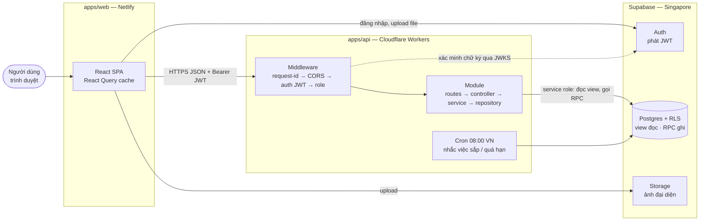
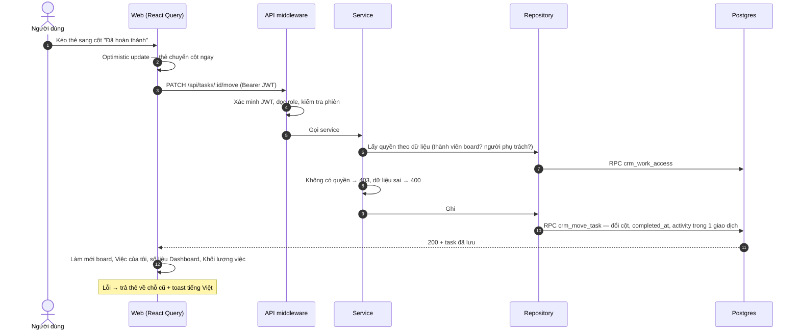
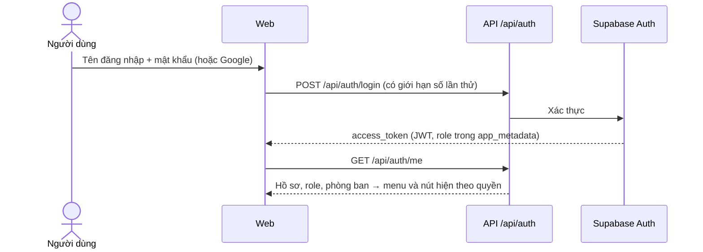
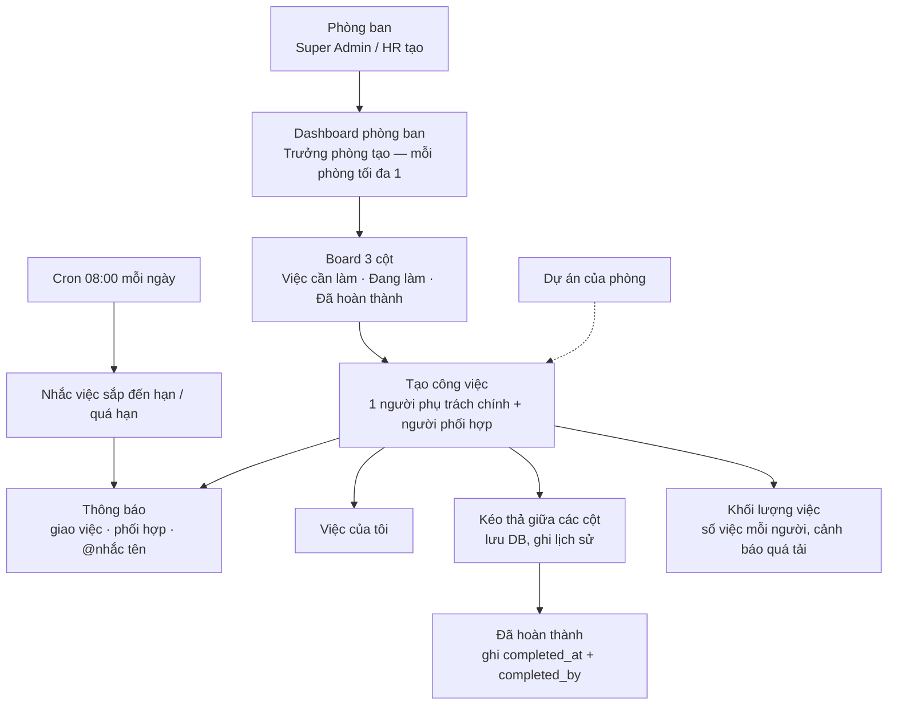

# CRM Business

Web app nội bộ cho một công ty, gộp **quản lý công việc** (Workspace, Dashboard phòng ban, Board kéo thả, Dự án) và
**quản lý nhân sự** (Nhân viên, Phòng ban, rồi Chấm công, Nghỉ phép, Lương, KPI…) vào một nơi. Giao diện tiếng
Việt, ưu tiên máy tính; tablet và điện thoại dùng được.

## Mục lục

- [Tính năng](#tính-năng)
- [Người dùng và phân quyền](#người-dùng-và-phân-quyền)
- [Kiến trúc](#kiến-trúc)
- [Web hoạt động như thế nào](#web-hoạt-động-như-thế-nào)
- [Cấu trúc thư mục](#cấu-trúc-thư-mục)
- [Quy trình phát triển](#quy-trình-phát-triển)
- [Chạy ở máy local](#chạy-ở-máy-local)
- [Tài liệu](#tài-liệu)
- [Bản quyền](#bản-quyền)

## Tính năng

Làm theo từng đợt; mỗi đợt đi trọn **migration → API → giao diện → tài liệu** trên database thật
([ADR 008](docs/decisions/008-vertical-slices-real-database.md)).

| Đợt | Nội dung                                                                                                               | Trạng thái                      |
| --- | ---------------------------------------------------------------------------------------------------------------------- | ------------------------------- |
| 1   | Khung ứng dụng (Sidebar, Header, phân quyền hiển thị, trang 403), **Phòng ban**, danh bạ **Nhân viên**                 | Xong                            |
| 2   | **Workspace, Dashboard phòng ban, Board** 3 cột kéo thả, chi tiết công việc (checklist, bình luận, lịch sử, thùng rác) | Xong                            |
| 3   | **Việc của tôi, Dự án, Thông báo** (giao việc, phối hợp, @nhắc tên, sắp / quá hạn), **tìm kiếm** và **+ Tạo nhanh**    | Xong, đang kiểm thử             |
| 4   | **Khối lượng việc**, Tổng quan cá nhân, Tổng quan điều hành, tab Công việc trong hồ sơ, Sơ đồ tổ chức                  | Đang làm (Khối lượng việc xong) |
| 5   | Phê duyệt, Nghỉ phép, Chấm công                                                                                        | Chưa làm                        |
| 6   | Tuyển dụng, Nhận việc / Nghỉ việc, Tài sản, Tài liệu                                                                   | Chưa làm                        |
| 7   | Bảng lương, KPI & Đánh giá, Báo cáo, Cài đặt, Nhật ký hệ thống                                                         | Chưa làm                        |

Module chưa làm vẫn có mục menu và hiện "Tính năng đang được xây dựng" — không có dữ liệu giả.

## Người dùng và phân quyền

| Role              | Phạm vi chính                                                             |
| ----------------- | ------------------------------------------------------------------------- |
| CEO / Super Admin | Toàn công ty: mọi phòng ban, nhân viên, Dashboard, dự án, khối lượng việc |
| HR Admin          | Quản lý phòng ban, xem Workspace (chỉ đọc), sau này nghỉ phép / lương     |
| Trưởng phòng      | Phòng mình: tạo Dashboard, dự án, giao và sửa việc, xem khối lượng việc   |
| Trưởng nhóm       | Phòng mình: giao và sửa việc, xem khối lượng việc                         |
| Nhân viên         | Việc mình phụ trách / phối hợp, Dashboard phòng mình hoặc được mời        |

Quyền luôn kiểm tra ở **backend** (hai tầng: theo role ở middleware, theo dữ liệu ở service). Ẩn nút trên giao
diện chỉ là phụ. Ma trận đầy đủ: [permission-model.md](docs/architecture/permission-model.md).

## Kiến trúc

Monorepo **pnpm + Turborepo**, TypeScript strict ở mọi nơi.

| Lớp     | Công nghệ                                                            | Chạy ở                     |
| ------- | -------------------------------------------------------------------- | -------------------------- |
| Web     | React 19, Vite, React Query, react-router, Tailwind CSS (`apps/web`) | Netlify                    |
| API     | Hono, zod, jose (`apps/api`)                                         | Cloudflare Workers + Cron  |
| Dữ liệu | Postgres + Row Level Security, Auth, Storage (`supabase/`)           | Supabase, region Singapore |



Ba nguyên tắc giữ cho hệ thống an toàn và dễ đoán:

1. **Mọi thao tác ghi đi qua API.** Trình duyệt chỉ dùng Supabase trực tiếp cho đăng nhập và upload file.
2. **Database là nguồn sự thật.** Bảng bật RLS và từ chối mặc định; API đọc qua view, ghi qua RPC `security definer`
   trong một giao dịch, kèm activity / audit log không xoá được.
3. **Mỗi thay đổi schema là một migration mới** trong `supabase/migrations/`, kiểm tra migration trước đã chạy.

## Web hoạt động như thế nào

### Một thao tác từ lúc bấm đến lúc màn hình cập nhật

Ví dụ: kéo một công việc sang cột "Đã hoàn thành".



### Đăng nhập



Role chỉ đọc từ `app_metadata` (chỉ server ghi được). Hết phiên → về trang đăng nhập, nhớ trang đang mở.

### Luồng công việc chính



Quy tắc nghiệp vụ cốt lõi (đầy đủ ở [business-rules.md](docs/requirements/business-rules.md)): phòng ban và
Dashboard là hai thứ riêng; tạo phòng ban không tự tạo Dashboard; công việc tạo trong Dashboard tự gán phòng của
Dashboard; lịch sử hoạt động không bị xoá.

## Cấu trúc thư mục

```
apps/
  web/src/
    app/            cấu hình: providers, router (lazy load theo trang)
    layouts/        Sidebar, Header (tìm kiếm, + Tạo nhanh, chuông thông báo), menu
    features/<module>/
      api/ hooks/ components/ pages/ types.ts index.ts
    components/ui/  Button, Table, Modal, Badge, EmptyState… (dùng chung)
    lib/            api-client, format ngày, tiện ích dùng chung
  api/src/
    middleware/     request-id, auth (JWT), permission (role), error
    modules/<module>/
      *.routes.ts → *.controller.ts → *.service.ts → *.repository.ts (+ schema zod, types)
    lib/            supabase client, phân trang, quyền theo dữ liệu
supabase/
  migrations/       mỗi thay đổi DB một file, áp theo thứ tự
  tests/            kiểm tra trên database thật, tự ROLLBACK
docs/               sản phẩm, nghiệp vụ, kiến trúc, API, database, UI/UX, kiểm thử
rules/              quy tắc bắt buộc khi viết code
```

Tên module giống nhau ở web và API (`tasks`, `projects`, `workload`…); danh sách ở
[architecture-rules.md](rules/architecture-rules.md).

## Quy trình phát triển

```mermaid
flowchart LR
  a["Đọc nghiệp vụ<br/>docs/features, business-rules"] --> b["Migration mới<br/>+ test SQL"]
  b --> c["API module<br/>quyền · validate · audit"]
  c --> d["Giao diện<br/>đủ 4 trạng thái: tải, trống, lỗi, dữ liệu"]
  d --> e["Tài liệu<br/>docs/api, docs/database"]
  e --> f["Kiểm tra<br/>lint · typecheck · test · prettier · build"]
  f --> g["Commit + push nhánh feat/*"]
  g --> h["Kiểm thử thủ công"]
  h --> i["Pull request vào main"]
  i --> j["Áp migration → deploy API → deploy web"]
```



- Nhánh `main` luôn chạy được; làm việc trên `feat/<module>-<mô-tả>`, `fix/…`, `docs/…`.
- Commit theo Conventional Commits: `feat(tasks): kéo thả task giữa các cột`.
- Không commit `.env`, `.dev.vars`, file build — đã có trong `.gitignore`.
- Chi tiết: [CONTRIBUTING.md](CONTRIBUTING.md), [rules/git-rules.md](rules/git-rules.md),
  [rules/code-quality-rules.md](rules/code-quality-rules.md).

## Chạy ở máy local

Cần Node.js 20+ và một project Supabase (xem [docs/development/local-development.md](docs/development/local-development.md)).

```bash
corepack enable && corepack prepare pnpm@10.18.0 --activate
pnpm install
cp apps/web/.env.example apps/web/.env.local     # điền VITE_*
cp apps/api/.dev.vars.example apps/api/.dev.vars # điền SUPABASE_*
pnpm dev   # web: http://localhost:5173 · api: http://localhost:8787/api/health
```

Áp migration theo đúng thứ tự trong [docs/changelog/migrations.md](docs/changelog/migrations.md).

| Lệnh             | Việc                                     |
| ---------------- | ---------------------------------------- |
| `pnpm dev`       | Chạy web và API                          |
| `pnpm lint`      | ESLint cả hai app                        |
| `pnpm typecheck` | Kiểm tra kiểu TypeScript                 |
| `pnpm test`      | Test API (`node --test`) và web (vitest) |
| `pnpm build`     | Build production                         |

## Tài liệu

- Mô tả sản phẩm: [PROJECT_DESCRIPTION.md](PROJECT_DESCRIPTION.md), [docs/product/](docs/product/)
- Kiến trúc: [ARCHITECTURE.md](ARCHITECTURE.md), [docs/architecture/](docs/architecture/)
- Nghiệp vụ: [docs/requirements/business-rules.md](docs/requirements/business-rules.md), [docs/features/](docs/features/)
- API: [docs/api/endpoints/](docs/api/endpoints/) · Database: [docs/database/](docs/database/)
- Giao diện: [docs/ui-ux/frontend-spec.md](docs/ui-ux/frontend-spec.md)
- Quyết định đã chốt: [docs/decisions/](docs/decisions/)
- Quy tắc cho người và AI viết code: [CLAUDE.md](CLAUDE.md), [rules/](rules/)

## Bản quyền

© 2026 **ThongTran**. Mọi quyền được bảo lưu — xem [LICENSE](LICENSE).
